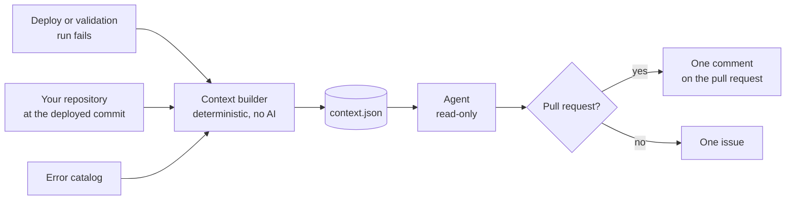

# 🩺 Deploy Doctor for Salesforce

[](https://github.com/rammc/sf-deploy-doctor/actions/workflows/ci.yml)
[](LICENSE)
[](https://github.com/github/gh-aw)

An open source agent for your Salesforce pipeline. When a deployment or validation in GitHub Actions goes red, Deploy Doctor reads the failure, finds the root causes and writes **one report**: what broke, whether the change or the target org is responsible, and what to do next.

A second workflow, the **pre-flight**, looks at a pull request before anything is deployed and points out what is likely to fail.

Both run as [GitHub Agentic Workflows](https://github.com/github/gh-aw) in your own repository, are read-only by design, and install with one command each.

> **Status: early.** Both workflows have run against real orgs in a test repository; the examples on this page are their unedited output ([diagnosis](docs/example-report.md), [pre-flight](docs/example-preflight.md), [pre-flight with many risks](docs/example-preflight-combined.md), [pre-flight for a Lightning web component](docs/example-preflight-lwc.md)). They have not been used on a production pipeline yet. Expect changes.

## 😵 The problem

A failed Salesforce deployment tells you everything and explains nothing:

```text
Component Failures [4]
┌───────────────┬──────────────────────────┬──────────────────────────────────────────────────────────────┐
│ Type          │ Name                     │ Problem                                                      │
├───────────────┼──────────────────────────┼──────────────────────────────────────────────────────────────┤
│ CustomField   │ Account.Doctor_Lookup__c │ referenceTo value of 'Doctor_Missing_Object__c' does not     │
│               │                          │ resolve to a valid sObject type                              │
│ ApexClass     │ DoctorBrokenService      │ No such column 'Doctor_Missing_Field__c' on entity 'Account' │
│ ApexClass     │ DoctorBrokenService      │ Variable does not exist: Doctor_Missing_Field__c             │
│ PermissionSet │ Doctor_Access            │ In field: field - no CustomField named                       │
│               │                          │ Account.Doctor_Other_Missing__c found                        │
└───────────────┴──────────────────────────┴──────────────────────────────────────────────────────────────┘
```

Four errors. How many causes? Did this pull request break it, or was the org already different? Is the field missing from the repository or only from this deployment? Somebody has to open the log, know the error messages, search the repository and compare with the diff. On a busy team that is the same two or three people every time, and it happens several times a week.

## 💡 What you get instead

Deploy Doctor does that reading and answers on the pull request. This is what it wrote for the log above in a live run against a sandbox, shortened to the summary and one of three causes:

> **Summary**
>
> This validation (check-only, dry run) failed because the deployment references three components that do not exist anywhere in the repository: the custom object `Doctor_Missing_Object__c`, and two custom fields, `Account.Doctor_Missing_Field__c` and `Account.Doctor_Other_Missing__c`. All four reported failures are missing-dependency errors, and all of them trace back to files changed in this run, so the change itself is the cause, not the target org. Fix this by either adding the missing object/field metadata to the deployment or correcting the names if they were meant to reference something else.
>
> `componentFailures: 4` · `testFailures: 0` · `coverageWarnings: 0` · `otherErrors: 0` · `2/6` components deployed — run #2
>
> **2. `DoctorBrokenService` queries and reads a field that does not exist on `Account`**
>
> `force-app/main/default/classes/DoctorBrokenService.cls:3` runs `SELECT Id, Doctor_Missing_Field__c FROM Account`, and line 4 reads `a.Doctor_Missing_Field__c`. There is no `Doctor_Missing_Field__c` field under `force-app/main/default/objects/Account/fields/` (only `Doctor_Lookup__c` exists there), so this field is missing from the repository entirely, not merely excluded from this deployment. This class was changed in this run. Confidence: high.
> Next step: add the `Account.Doctor_Missing_Field__c` field metadata to the deployment, or update `DoctorBrokenService.cls` to use the correct field name.
>
> **Follow-up errors**
>
> - The `Variable does not exist: Doctor_Missing_Field__c` Apex compile error on `DoctorBrokenService.cls:4` is a direct follow-up of cause 2 (the SOQL failure on line 3) and will disappear once that field is added or the query is corrected.
>
> **Not explained**
>
> `Doctor_Access.permissionset-meta.xml` also lists `<classAccesses><apexClass>DoctorNoSuchClass</apexClass></classAccesses>` (line 4), referencing an Apex class that is not present in `force-app/main/default/classes`. This was not reported among the four failures in this run's log, possibly because validation stopped reporting further errors for this component after the field-permission error above. Worth checking once cause 3 is fixed, since it looks like it would fail the same way.

Four errors became three causes with one owner. The last paragraph is a fifth problem that the org had not reported yet; the doctor found it while reading the permission set. The full, unedited report is in [docs/example-report.md](docs/example-report.md).

## ⚙️ How it works

Deploy Doctor follows one rule: **facts are collected by code, judgement is left to the agent.**



1. **The context builder collects the facts.** A single Python script reads the logs of the failed run and extracts every component failure, test failure and coverage warning. It matches each one against a catalog of known Salesforce error patterns and against your repository.
2. **The agent diagnoses.** It reads the resulting `context.json`, groups errors that share a cause, separates root causes from follow-up errors and decides who has to act.
3. **One report.** A comment on the pull request if the run belongs to one, otherwise an issue. Older doctor issues are closed automatically.

### Why not just let an AI read the log?

Because a log alone cannot answer the question that matters: *is it my change or the org?* The context builder adds three facts to every finding that are not in the log:

| Fact | What it tells you |
| --- | --- |
| `sourceFile` | Which file in the repository the failing component is. |
| `changedInThisRun` | Whether that file was touched by the commits of this run. If not, the cause is likely the org or another change. |
| `reference.inRepository` | For a missing dependency: whether the missing component exists in the source at all. If yes, it did not reach the org (delta too narrow, manifest, `.forceignore`, field-level security). If no, it lives only in another org or the name is wrong. |

The agent never counts and never parses. Numbers in the report come from the context file, and the same log always produces the same context.

## 🔎 What it recognises

The catalog (`doctor/catalog.json`) currently holds 35 patterns in seven categories. A failure that matches no pattern is still reported; the agent classifies it from the text and says so.

| Category | Examples |
| --- | --- |
| **Missing dependency** | A field, object or class the org does not have; a permission set that still lists a deleted field; a manifest entry without a file; a Lightning web component that imports a missing class, field, label, static resource or child component |
| **Code** | Apex that does not compile, signature mismatches, follow-up errors of an invalid class; a Lightning web component that does not compile or imports an Apex method without `@AuraEnabled` |
| **Test failure** | Assertions, required fields, validation rules, duplicate rules, row locks, mixed DML, governor limits |
| **Coverage** | A deployed class below 75 % with `RunSpecifiedTests`, or the org below 75 % |
| **Org state** | Active flow versions, components still in use, blocked field type changes, name collisions, source conflicts |
| **Permissions** | Missing access of the deploying user, unknown user permissions, missing features or licenses |
| **Environment** | Expired authentication, network errors, timeouts, platform availability |

## 🛫 Pre-flight: before the deployment

The cheapest failed deployment is the one that never starts. The pre-flight workflow runs on every pull request that touches metadata. A script reads the diff and collects signals; only if there is at least one does the agent wake up, check each signal against the source and write one comment with a verdict.

| Signal | Severity | What it catches |
| --- | --- | --- |
| `reference-not-in-source` | high | The change refers to a field, object or class that is not defined anywhere in the repository. For Lightning web components and Aura this covers every `@salesforce/...` import (Apex, schema, labels, static resources, custom permissions, message channels), `c/...` modules and `<c-...>` tags |
| `apex-method-not-exposed` | high | A component imports an Apex method that the class does not declare or declares without `@AuraEnabled`, including the case where a change to the class breaks a component that is not part of the pull request |
| `deleted-still-referenced` | high | A component is deleted while other files still use it |
| `field-type-change` | high | The type of an existing field changes |
| `new-required-field` | medium | A field becomes required: tests and integrations that create the object without it start to fail |
| `field-becomes-unique` | medium | An existing field becomes unique: fails if the org holds duplicates |
| `validation-rule-active` | medium | An active validation rule is added or its condition changes |
| `ui-reference-not-in-source` | medium | A UI bundle (a React, Angular or other front-end application) names a custom field or object that is not in the repository. The bundle deploys, the query fails at run time |
| `apex-without-test` | medium | No test class refers to a changed Apex class or trigger |
| `active-flow-change` | medium | An active flow is modified |
| `destructive-change` | medium / low | A component is deleted from the source; fields and objects take their data with them |
| `profile-change`, `package-reference` | low | Profiles in the change, references to managed package components |

Lightning web components gain the most from this. An org does not report all broken imports of a deployment at once: in the test run behind [this example](docs/example-preflight-lwc.md) the validation named two of four problems, and the other two would have appeared only after a fix and another attempt. The pre-flight listed all four before the first deployment.

The signals come from the source alone, so the pre-flight needs no org and no credentials. It says what the diff shows, not what an org will do, and it never approves or blocks a pull request. A pull request without signals gets no comment at all.

This is the unedited comment on the sample change from the top of this page, written before any validation ran. It names all three missing references and a fourth one, the Apex class, that the org itself never reported:

> **Verdict: Likely to fail.** All three new components reference names — a field, an object, another field, and an Apex class — that are not defined anywhere in this repository. They all follow this PR's own `Doctor_` / `Doctor` naming, which suggests pieces of the change were left out rather than that these are long-standing org components.
>
> `3 components added (1 ApexClass, 1 CustomField, 1 PermissionSet), 0 modified, 0 deleted` — `4 high, 1 medium, 0 low signals`
>
> ### Likely to fail
>
> - `force-app/main/default/classes/DoctorBrokenService.cls:3` queries `Doctor_Missing_Field__c` on `Account`, but no `CustomField` named `Doctor_Missing_Field__c` exists in the source. If it is not already present in the target org, the SOQL compile step fails the deployment.
> - `force-app/main/default/objects/Account/fields/Doctor_Lookup__c.field-meta.xml:2` sets `<referenceTo>Doctor_Missing_Object__c</referenceTo>`, but no object by that name is defined in the source. A lookup field cannot deploy to a target object that does not exist.
> - `force-app/main/default/permissionsets/Doctor_Access.permissionset-meta.xml:3` grants access to `Account.Doctor_Other_Missing__c`, a third field name distinct from `Doctor_Missing_Field__c` above, and it is also not defined anywhere in the source.
> - `force-app/main/default/permissionsets/Doctor_Access.permissionset-meta.xml:4` grants class access to `DoctorNoSuchClass`, which is a different name from the `DoctorBrokenService` class added in this same PR and is not defined anywhere in the source.
>
> Fix: either add the missing `Doctor_Missing_Field__c` field, `Doctor_Missing_Object__c` object and `DoctorNoSuchClass` class (or correct what look like typos against the components actually in this PR), or confirm each one already exists in every target org before deploying.
>
> ### Risks after deployment
>
> - No test class in the source refers to `DoctorBrokenService` (`force-app/main/default/classes/DoctorBrokenService.cls`). If this org requires 75% coverage or uses `RunSpecifiedTests`, this class will not count toward coverage on its own, independent of the missing-reference issues above.
>
> ### Check before merging
>
> - Does `Account.Doctor_Missing_Field__c` already exist in the target org?
> - Does the object `Doctor_Missing_Object__c` already exist in the target org?
> - Does `Account.Doctor_Other_Missing__c` already exist in the target org?
> - Does the Apex class `DoctorNoSuchClass` already exist in the target org?
> - Is there a test class elsewhere (not in this PR) that already covers `DoctorBrokenService`?

A second, larger example shows the other rules at work: a pull request that deletes a class and a field still in use, changes a field type, makes a field required and adds a validation rule. The pre-flight names the two existing tests that will break, although no signal pointed at them; it found them by reading the source. See [docs/example-preflight-combined.md](docs/example-preflight-combined.md).

A harmless pull request in the same test produced no signal, no agent run and no comment.

## 🚀 Quick start

**Prerequisites:** a repository whose Salesforce deployments or validations run in GitHub Actions, the [GitHub CLI](https://cli.github.com/) and Python 3.9 or newer. You do not clone or fork this repository; you install its workflows into yours.

Run these in the root of your Salesforce repository:

```bash
# 1. Install both workflows and the setup script
gh extension install github/gh-aw
gh aw add rammc/sf-deploy-doctor@v0.2.0

# 2. Let the setup script find your deploy workflows, branches and package directories
python3 .github/aw/deploy-doctor/setup.py            # shows what it found
python3 .github/aw/deploy-doctor/setup.py --write    # writes it into the two workflow files

# 3. Compile, add the secret of your AI engine, commit
gh aw compile
gh aw secrets bootstrap
git add .gitattributes .github && git commit -m "Add Deploy Doctor"
```

Merge the commit to your default branch. From then on every failed run of your deploy workflows gets a diagnosis, and every pull request that carries a risk gets a pre-flight comment.

<details>
<summary><b>What each step does</b></summary>

1. `gh aw add` copies `deploy-doctor.md` and `deploy-preflight.md` to `.github/workflows`, compiles them to `.lock.yml` files and puts the setup script under `.github/aw/deploy-doctor`. To install only one of the two, name it: `gh aw add rammc/sf-deploy-doctor/deploy-preflight@v0.2.0`.
2. The setup script reads `.github/workflows` and `sfdx-project.json`. It looks for workflows that run `sf project deploy`, the older `sfdx force:source:deploy`, sfp or a deploy action, also behind reusable workflows, local actions and shell scripts. It writes their names and the branch patterns of your repository into the trigger of the doctor, and your package directories into the path filter of the pre-flight. It changes nothing else and sends nothing anywhere. If it misses a workflow, name it yourself: `--workflows "Deploy,PR Validation" --branches "main,feature/**"`.
3. `gh aw secrets bootstrap` lists the secrets the workflows need and asks for the missing ones.

</details>

### Choose the AI engine

The workflows run on any engine gh-aw supports. Copilot is the default; pass `--engine` to `gh aw add` for another one, or set `engine:` in the frontmatter of both workflow files and compile again.

| Engine | Install with | Secret |
| --- | --- | --- |
| GitHub Copilot (default) | `gh aw add rammc/sf-deploy-doctor@v0.2.0` | `COPILOT_GITHUB_TOKEN`, or no secret at all with `permissions: copilot-requests: write` where your organisation has central Copilot billing |
| Claude | `gh aw add rammc/sf-deploy-doctor@v0.2.0 --engine claude` | `ANTHROPIC_API_KEY` |
| Codex and others | `gh aw add rammc/sf-deploy-doctor@v0.2.0 --engine codex` | shown by `gh aw secrets bootstrap` |

The examples on this page were written with Claude. With an engine other than Copilot, `gh aw add` prints a notice about a new restricted secret; it tells you that the workflow will read that secret, which is what you asked for.

### Try it on a run that already failed

You do not have to wait for the next red deployment. Once the workflows are on your default branch, point the doctor at an old failure:

```bash
gh run list --workflow "<your deploy workflow>" --status failure --limit 5   # pick a run id
gh workflow run deploy-doctor.lock.yml -f run_id=1234567890
```

A few minutes later the diagnosis is on the pull request of that run, or in a new issue if the run had none.

### Versions and updates

The install command names a tagged release. The installed workflows check out the context builders at the same tag, so nothing in your pipeline changes until you decide to update:

```bash
gh aw update            # move the installed workflows to the latest release
```

`gh aw update` merges the new version with your local changes, such as the trigger the setup script wrote, and recompiles. What changed between releases is listed in the [changelog](CHANGELOG.md).

### If something does not work

| What you see | Why | What to do |
| --- | --- | --- |
| Nothing happens after a failed deployment | The workflows are not on the default branch yet. gh-aw reads the workflow from there, and `workflow_run` only fires for workflows on the default branch | Merge the commit that adds them |
| Still nothing | The name of your deploy workflow or the branch of the run is not in the trigger | Compare `workflows:` and `branches:` in `deploy-doctor.md` with the failed run, run the setup script again or pass `--workflows` and `--branches`, then `gh aw compile` |
| `CTR-021 ... workflow_run lacks positive branch scope` on compile | gh-aw does not accept a bare wildcard such as `**` for the branches | Use names or scoped patterns: `main`, `feature/**`, `PROJ-*` |
| The doctor reports that test details are missing | In CI the Salesforce CLI prints how many tests failed, not which | Add the report step under [Works with your pipeline](#-works-with-your-pipeline) |
| The run fails in the agent job with an authentication error | The secret of the engine is missing or expired | `gh aw secrets bootstrap` |
| No pre-flight comment on a pull request | The diff carries no signal, or it touches no file under the path filter. Both are intended: no finding, no comment | Check `paths:` in `deploy-preflight.md` if your metadata lives elsewhere |
| The run fails with `Failed to resolve runtime import path` | The workflow exists only on the pull request branch | Merge it to the default branch first |

## 🧩 Works with your pipeline

The doctor does not replace or wrap your deployment. It only needs the output of the Salesforce CLI in the job log:

- `sf project deploy start` and `sf project deploy validate`, with or without `--dry-run`
- the composite actions of the [Salesforce DevOps Starter Kit](https://github.com/svierk/salesforce-devops-starter-kit), for example [`svierk/sfdx-deploy`](https://github.com/svierk/sfdx-deploy)
- any other wrapper that prints the CLI result

If the log contains the `--json` result of the deploy command, the doctor uses that instead of the human-readable table.

### Recommended: print the deploy report on failure

In CI the Salesforce CLI runs without a terminal, and then it reports *how many* Apex tests failed but not *which ones* or why. Add one step after your deployment so the full result lands in the log:

```yaml
- name: Deploy report for Deploy Doctor
  if: failure()
  run: sf project deploy report --use-most-recent --json || true
```

Deploy Doctor picks the result up from the log. Without this step it still diagnoses component failures and coverage, and for failed tests it tells you that the details are missing and how to add them, instead of guessing.

## 🔐 Security model

- **No org access.** The agent never receives credentials for Salesforce and cannot call the org. Only your existing deploy workflow talks to it.
- **Read-only in the repository.** The workflow runs with `contents: read`. The agent cannot push, re-run or approve anything. Its only outputs are one comment or one issue, enforced by gh-aw [safe outputs](https://github.github.com/gh-aw/).
- **Log text is data.** Error messages from the org are treated as untrusted input. Usernames, e-mail addresses and record ids are removed before the agent sees the context.
- **Small tool surface.** The agent has a short allowlist of read-only shell commands (`cat`, `grep`, `jq` and similar).

## 🛠️ Use the analysis without the agent

Both context builders are plain Python without dependencies. They are useful on their own, for example to post-process a failed deployment in another CI system:

```bash
# from a saved log
python3 doctor/deploy_context.py --log-file deploy.log --repo-dir . --out context.json

# from the JSON result of the CLI
sf project deploy start --dry-run --json > result.json
python3 doctor/deploy_context.py --result-json result.json --repo-dir . --out context.json

# from a GitHub Actions run
python3 doctor/deploy_context.py --run-id 1234567890 --out context.json

# pre-flight signals of a branch
python3 doctor/preflight_context.py --base origin/main --head HEAD --out preflight.json
```

<details>
<summary>Excerpt of a context file</summary>

```json
{
  "type": "PermissionSet",
  "name": "Doctor_Access",
  "problem": "In field: field - no CustomField named Account.Doctor_Other_Missing__c found",
  "patternId": "missing-named-component",
  "category": "missing-dependency",
  "title": "A component refers to another component that is not in the org",
  "sourceFile": "force-app/main/default/permissionsets/Doctor_Access.permissionset-meta.xml",
  "changedInThisRun": false,
  "reference": {
    "name": "Account.Doctor_Other_Missing__c",
    "inRepository": false
  }
}
```

</details>

## 🗺️ Roadmap

- **Enrichment:** fetch the full result with `sf project deploy report` when the log is incomplete.
- **History:** recognise a failure that already occurred in earlier runs and say since when.
- **Skill:** the same doctor as an agent skill for local use.

## 🤝 Contributing

The most valuable contribution is an error the doctor does not know yet. Add one entry to `doctor/catalog.json` (pattern, category, title, advice), one line to the test `test_known_messages`, and open a pull request. The details, and how to report a false alarm of the pre-flight, are in [CONTRIBUTING.md](CONTRIBUTING.md). Security reports go through [SECURITY.md](SECURITY.md).

```bash
python3 -m unittest discover -s tests
```

The fixtures under `tests/fixtures` are real output of check-only validations with deliberately broken metadata. Org identifiers are removed.

## 🙏 Related work

- [github/gh-aw](https://github.com/github/gh-aw) and [githubnext/agentics](https://github.com/githubnext/agentics): the runtime and the sample workflows this project follows, in particular the CI Doctor.
- [svierk/salesforce-devops-starter-kit](https://github.com/svierk/salesforce-devops-starter-kit): composable GitHub Actions for Salesforce CI/CD. A good pipeline to put the doctor behind.

## 📄 License

[MIT](LICENSE). Not affiliated with or endorsed by Salesforce.
