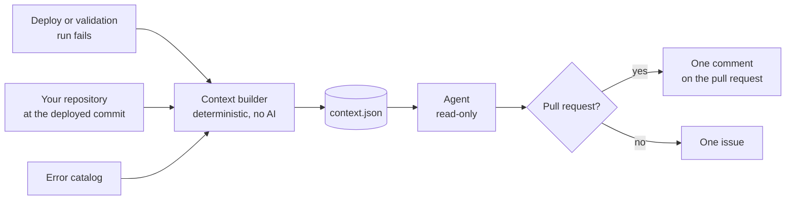

# 🩺 Deploy Doctor for Salesforce

[](https://github.com/rammc/sf-deploy-doctor/actions/workflows/ci.yml)
[](LICENSE)
[](https://github.com/github/gh-aw)

An open source agent for your Salesforce pipeline. When a deployment or validation in GitHub Actions goes red, Deploy Doctor reads the failure, finds the root causes and writes **one report**: what broke, whether the change or the target org is responsible, and what to do next.

It runs as a [GitHub Agentic Workflow](https://github.com/github/gh-aw) in your own repository, is read-only by design, and installs with one command.

> **Status: early.** The doctor has diagnosed its first real validation failures in a test repository; see the [example report](docs/example-report.md). It has not been used on a production pipeline yet. Expect changes.

## 😵 The problem

A failed Salesforce deployment tells you everything and explains nothing:

```text
Component Failures [4]
┌───────────────┬──────────────────────────┬──────────────────────────────────────────────────────────────┐
│ Type          │ Name                     │ Problem                                                      │
├───────────────┼──────────────────────────┼──────────────────────────────────────────────────────────────┤
│ CustomField   │ Account.Doctor_Lookup__c │ referenceTo value of 'Doctor_Missing_Object__c' does not     │
│               │                          │ resolve to a valid sObject type                              │
│ ApexClass     │ DoctorBrokenService      │ No such column 'Doctor_Missing_Field__c' on entity 'Account' │
│ ApexClass     │ DoctorBrokenService      │ Variable does not exist: Doctor_Missing_Field__c             │
│ PermissionSet │ Doctor_Access            │ In field: field - no CustomField named                       │
│               │                          │ Account.Doctor_Other_Missing__c found                        │
└───────────────┴──────────────────────────┴──────────────────────────────────────────────────────────────┘
```

Four errors. How many causes? Did this pull request break it, or was the org already different? Is the field missing from the repository or only from this deployment? Somebody has to open the log, know the error messages, search the repository and compare with the diff. On a busy team that is the same two or three people every time, and it happens several times a week.

## 💡 What you get instead

Deploy Doctor does that reading and answers on the pull request. This is what it wrote for the log above, in a live run against a sandbox:

> **Summary**
>
> This was a check-only validation of branch `feat/account-score` that failed. All four component failures are the same kind of problem: metadata added or changed on this branch refers to custom fields, a custom object, and an Apex class that do not exist anywhere in this repository. This is not an org-drift or environment issue; it is incomplete metadata on this branch, and the author of the change needs to act.
>
> **Totals:** 4 component failures (4 missing-dependency), 0 test failures, 0 coverage warnings, 0 other errors.
>
> **2. New class `DoctorBrokenService` queries and reads a field that does not exist — `Account.Doctor_Missing_Field__c`**
>
> `DoctorBrokenService.cls` (new in this run) runs `SELECT Id, Doctor_Missing_Field__c FROM Account` (line 3) and then reads `a.Doctor_Missing_Field__c` (line 4). No field with that API name exists in the repository under `objects/Account/fields`. The two reported errors are a single root cause: the second is a direct consequence of the first. Confidence: high. Next step: add the `Account.Doctor_Missing_Field__c` field to the deployment if it is meant to exist, or correct the field name in `DoctorBrokenService.cls` if it was meant to reference an existing field.
>
> **3. Permission set `Doctor_Access` grants access to a field that does not exist — `Account.Doctor_Other_Missing__c`**
>
> [...] A related, not-yet-surfaced problem in the same file: `Doctor_Access.permissionset-meta.xml` also grants class access to `DoctorNoSuchClass`, and no Apex class by that name exists in the repository either. This did not appear as a reported error in this run, but it will very likely fail the same way once the field-permission issue above is fixed. Recommend fixing it in the same pass.

Four errors became three causes with one owner, and the report names a fifth problem the org had not even reported yet. The full text is in [docs/example-report.md](docs/example-report.md).

## ⚙️ How it works

Deploy Doctor follows one rule: **facts are collected by code, judgement is left to the agent.**



1. **The context builder collects the facts.** A single Python script reads the logs of the failed run and extracts every component failure, test failure and coverage warning. It matches each one against a catalog of known Salesforce error patterns and against your repository.
2. **The agent diagnoses.** It reads the resulting `context.json`, groups errors that share a cause, separates root causes from follow-up errors and decides who has to act.
3. **One report.** A comment on the pull request if the run belongs to one, otherwise an issue. Older doctor issues are closed automatically.

### Why not just let an AI read the log?

Because a log alone cannot answer the question that matters: *is it my change or the org?* The context builder adds three facts to every finding that are not in the log:

| Fact | What it tells you |
| --- | --- |
| `sourceFile` | Which file in the repository the failing component is. |
| `changedInThisRun` | Whether that file was touched by the commits of this run. If not, the cause is likely the org or another change. |
| `reference.inRepository` | For a missing dependency: whether the missing component exists in the source at all. If yes, it did not reach the org (delta too narrow, manifest, `.forceignore`, field-level security). If no, it lives only in another org or the name is wrong. |

The agent never counts and never parses. Numbers in the report come from the context file, and the same log always produces the same context.

## 🔎 What it recognises

The catalog (`doctor/catalog.json`) currently holds 28 patterns in seven categories. A failure that matches no pattern is still reported; the agent classifies it from the text and says so.

| Category | Examples |
| --- | --- |
| **Missing dependency** | A field, object or class the org does not have; a permission set that still lists a deleted field; a manifest entry without a file |
| **Code** | Apex that does not compile, signature mismatches, follow-up errors of an invalid class |
| **Test failure** | Assertions, required fields, validation rules, duplicate rules, row locks, mixed DML, governor limits |
| **Coverage** | A deployed class below 75 % with `RunSpecifiedTests`, or the org below 75 % |
| **Org state** | Active flow versions, components still in use, blocked field type changes, name collisions, source conflicts |
| **Permissions** | Missing access of the deploying user, unknown user permissions, missing features or licenses |
| **Environment** | Expired authentication, network errors, timeouts, platform availability |

## 🚀 Quick start

**Prerequisites:** a repository whose Salesforce deployments or validations run in GitHub Actions, and the [gh-aw](https://github.com/github/gh-aw) extension for the GitHub CLI.

```bash
gh extension install github/gh-aw
gh aw add rammc/sf-deploy-doctor/deploy-doctor
```

This adds `.github/workflows/deploy-doctor.md` to your repository. Open it and adapt the trigger in the frontmatter:

```yaml
on:
  workflow_run:
    # the names of your workflows that deploy to or validate against an org
    workflows: ["Deploy", "Validate", "PR Validation"]
    types: [completed]
    # the branches whose runs the doctor looks at
    branches:
      - main
      - develop
      - "feature/**"
```

Choose the AI engine with `engine:` (Copilot is the gh-aw default; `claude` and `codex` are supported) and add the matching secret as described in the [gh-aw documentation](https://github.github.com/gh-aw/). Then compile and commit:

```bash
gh aw compile deploy-doctor
git add .github/workflows/deploy-doctor.* && git commit -m "Add Deploy Doctor"
```

From now on every failed run of the listed workflows gets a diagnosis. To examine an older run by hand, start the workflow with its run id:

```bash
gh workflow run deploy-doctor.lock.yml -f run_id=1234567890
```

## 🧩 Works with your pipeline

The doctor does not replace or wrap your deployment. It only needs the output of the Salesforce CLI in the job log:

- `sf project deploy start` and `sf project deploy validate`, with or without `--dry-run`
- the composite actions of the [Salesforce DevOps Starter Kit](https://github.com/svierk/salesforce-devops-starter-kit), for example [`svierk/sfdx-deploy`](https://github.com/svierk/sfdx-deploy)
- any other wrapper that prints the CLI result

If the log contains the `--json` result of the deploy command, the doctor uses that instead of the human-readable table.

## 🔐 Security model

- **No org access.** The agent never receives credentials for Salesforce and cannot call the org. Only your existing deploy workflow talks to it.
- **Read-only in the repository.** The workflow runs with `contents: read`. The agent cannot push, re-run or approve anything. Its only outputs are one comment or one issue, enforced by gh-aw [safe outputs](https://github.github.com/gh-aw/).
- **Log text is data.** Error messages from the org are treated as untrusted input. Usernames, e-mail addresses and record ids are removed before the agent sees the context.
- **Small tool surface.** The agent has a short allowlist of read-only shell commands (`cat`, `grep`, `jq` and similar).

## 🛠️ Use the analysis without the agent

The context builder is one Python file without dependencies. It is useful on its own, for example to post-process a failed deployment in another CI system:

```bash
# from a saved log
python3 doctor/deploy_context.py --log-file deploy.log --repo-dir . --out context.json

# from the JSON result of the CLI
sf project deploy start --dry-run --json > result.json
python3 doctor/deploy_context.py --result-json result.json --repo-dir . --out context.json

# from a GitHub Actions run
python3 doctor/deploy_context.py --run-id 1234567890 --out context.json
```

<details>
<summary>Excerpt of a context file</summary>

```json
{
  "type": "PermissionSet",
  "name": "Doctor_Access",
  "problem": "In field: field - no CustomField named Account.Doctor_Other_Missing__c found",
  "patternId": "missing-named-component",
  "category": "missing-dependency",
  "title": "A component refers to another component that is not in the org",
  "sourceFile": "force-app/main/default/permissionsets/Doctor_Access.permissionset-meta.xml",
  "changedInThisRun": false,
  "reference": {
    "name": "Account.Doctor_Other_Missing__c",
    "inRepository": false
  }
}
```

</details>

## 🗺️ Roadmap

- **Pre-flight:** assess the risk of a pull request before the validation runs: destructive changes, profile edits, flows, components without a test class.
- **Enrichment:** fetch the full result with `sf project deploy report` when the log is incomplete.
- **History:** recognise a failure that already occurred in earlier runs and say since when.
- **Skill:** the same doctor as an agent skill for local use.

## 🤝 Contributing

The most valuable contribution is an error the doctor does not know yet. Add one entry to `doctor/catalog.json` (pattern, category, title, advice), one line to the test `test_known_messages`, and open a pull request.

```bash
python3 -m unittest discover -s tests
```

The fixtures under `tests/fixtures` are real output of check-only validations with deliberately broken metadata. Org identifiers are removed.

## 🙏 Related work

- [github/gh-aw](https://github.com/github/gh-aw) and [githubnext/agentics](https://github.com/githubnext/agentics): the runtime and the sample workflows this project follows, in particular the CI Doctor.
- [svierk/salesforce-devops-starter-kit](https://github.com/svierk/salesforce-devops-starter-kit): composable GitHub Actions for Salesforce CI/CD. A good pipeline to put the doctor behind.

## 📄 License

[MIT](LICENSE). Not affiliated with or endorsed by Salesforce.
